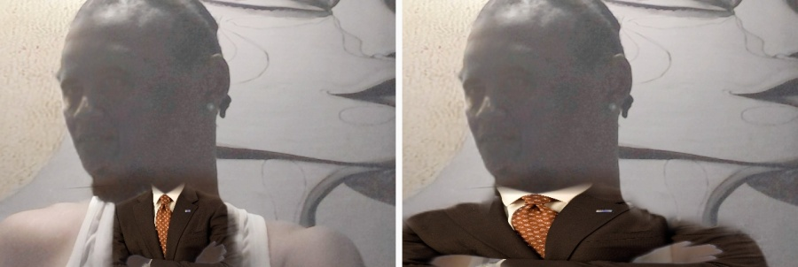
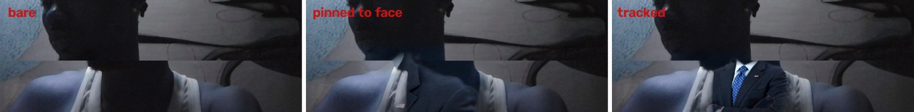
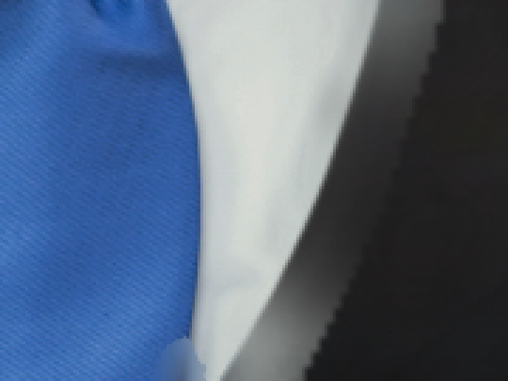
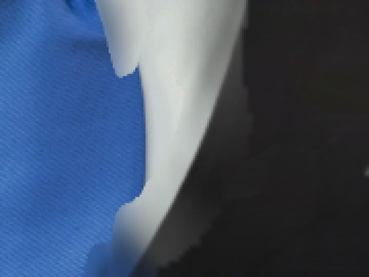

# MimicCam

**Real-time face and full-body character swap that shows up in Zoom, Telegram, WhatsApp and OBS as a normal webcam.** Windows, open source. The free engine runs on any DirectX 12 GPU; Lucy mode needs NVIDIA.

> **MimicCam is © 2026 Ray Bekson — [bigrayszn](https://github.com/bigrayszn/mimiccam).** This project, its name and its source are his. It is open source under **GPL-2.0-or-later**: fork it, read it, ship it, but the copyright and the original authorship stay with Ray Bekson. If you see MimicCam anywhere else, this is the repository it came from.

> **Download (Windows, free):** [MimicCam 0.2.2](https://github.com/bigrayszn/mimiccam/releases/latest) — the portable `.zip`, with checksums. Older releases stay on the [releases page](https://github.com/bigrayszn/mimiccam/releases).
> **Install and use:** [INSTALL.md](INSTALL.md) — requirements, the Decart key, the OBS virtual camera, call-app setup and a troubleshooting table.
> **No install wanted?** Every line of the app is in this repository: `pip install -r requirements.txt` then `python -m mimiccam`.

MimicCam has two engines behind one virtual camera:

- **Local (free, offline, default)** - a small identity-swap model runs on your own GPU. No API key, no subscription, no network after a one-time model download. It swaps the **face** (plus the character's hair and skin tone), and can transplant the character's **clothes** onto your own silhouette if you ask it to; it cannot change your body shape - that is a generative video model, not a 128 px face network.
- **Lucy 2.5 (paid)** - [Decart's Lucy 2.5](https://docs.platform.decart.ai/models/realtime/lucy-2.5) realtime video-to-video model over WebRTC. This is the **whole-person** mode: face, hair, body shape and complete outfit, at $0.02/s. See [How Lucy demand is phrased](#how-lucy-demand-is-phrased) - the wording is what makes the clothes change.

Either way your call app sees a webcam called **OBS Virtual Camera** (or **Unity Video Capture**) and never knows the difference.

```
 webcam ──► capture thread ──► ┌ local: YuNet -> ArcFace -> inswapper (DirectML, this GPU) ┐ ──► output thread ──► virtual camera ──► Zoom / Telegram / WhatsApp / OBS
   1080p        RGB, newest-first │ Lucy:  WebRTC session (cloud)                             │       fixed 30 fps cadence      DirectShow / Media Foundation
                                 └──────────────────────────────────────────────────────────┘
```

---

## Why this exists

Most "AI webcam" tools are either closed-source, phone-only, or a pile of scripts. MimicCam is a small, readable Python app you can fork:

- **One job per thread.** Capture, model transport and output never block each other, so the virtual camera keeps a steady frame rate even when the network hiccups.
- **No queue, no drift.** Only the newest frame is ever sent. Latency cannot grow over a long call.
- **Holds the last good frame** when the model goes quiet for a moment, instead of flashing black.
- **Reconnects itself** with exponential backoff if the WebRTC session drops mid-call.
- **Passthrough mode** lets you prove your camera and virtual camera work before spending a single credit.
- **The free engine never sees a network.** Download the models once, unplug, and it still works.
- **Your camera background is optional.** Tick *Seat me in the reference photo's room* and the free engine replaces the whole camera background with the room from your character photo, and seats you in it.

## What the free engine is, honestly

Lucy 2.5 is a datacentre-scale video diffusion model. There is no free download of
it, and no laptop runs a clone of it: the closest open equivalents (StreamDiffusion
+ SD-Turbo, 10-20 GB of weights) render 512 px at 5-10 fps on this class of GPU and
still do not hold a character's identity across frames.

What *does* run locally, in real time, is a **learned identity swap**: the face in
your webcam is re-rendered wearing the identity from a photo you choose, then blended
back with a soft face mask. That covers the thing people actually use a character
webcam for - looking like someone else on a call - at zero marginal cost.

| | Local (free) | Lucy 2.5 (paid) |
|---|---|---|
| Cost | $0, forever | $0.02 per second |
| Network | none after download | 2-4 Mbps, always |
| What changes | the face (identity), plus the room behind you if you ask for it | the whole frame: style, body, background |
| Reference photo | required for a swap | required for character mode |
| Latency | ~16 ms per frame | ~300 ms + network |
| Output | 30 fps, identity refreshed ~19x/s | 30 fps generative |
| Licence of weights | InsightFace, non-commercial research | commercial, per Decart's terms |

## Requirements

| | |
|---|---|
| OS | Windows 10/11, 64-bit |
| GPU | Any DirectX 12 GPU for the local engine (tested on an RTX 4070 Laptop, 8 GB); **NVIDIA required for Lucy**, which refuses to start without one instead of stuttering through your call. Passthrough needs neither. |
| Python | 3.10+ (only when running from source) |
| Virtual camera | **OBS Studio** (recommended, its virtual camera ships with it) **or** Unity Capture |
| Account | none for the local engine; a Decart API key only for Lucy |
| Disk | ~700 MB for the local models (downloaded once by the app) |
| Network | none for the local engine; ~2-4 Mbps up/down for Lucy |

## Install from source

```bat
git clone https://github.com/bigrayszn/mimiccam.git
cd mimiccam
py -3.10 -m venv .venv
.venv\Scripts\python -m pip install -r requirements.txt
.venv\Scripts\python -m mimiccam
```

Then, in the app:

1. **Camera** - pick your real webcam. Devices that deliver no light are labelled *black - IR camera?*.
2. **Virtual cam** - leave on *Auto*; MimicCam reports which backend it found.
3. **Engine** - start with *Passthrough* and press **Start camera**. Open your call app's video settings and select **OBS Virtual Camera**. You should see yourself. This proves the whole path.
4. Switch to **Local model (free, offline)**, load a character photo, press Start. The first run offers a ~700 MB download; after that it works with the network off.
5. Tick **Seat me in the reference photo's room** if you want the room from that photo behind you instead of your own wall. The first run downloads ~220 MB more and spends a few seconds building the empty room; the log says *Studio background ready* when it is done.
6. Only if you want generative restyling: paste your Decart key, press **Save** (it goes to Windows Credential Manager, never to a config file), switch to *Lucy 2.5* and press Start again.

The preview pane has two views. **Output** is what the virtual camera sends, which is what callers see; **Camera** is your webcam with no model in the way, and it opens the device on its own when you are idle, so you can check framing, light and which lens Windows picked *before* starting (and before any credit is spent). Mid-call it is the honest answer to "is that the camera or the model?" - the preview switch never adds a second capture, and while Camera is selected your call keeps receiving the processed output. The view is a session-only choice: MimicCam does not grab your webcam at launch, because that would fight Teams and OBS for the device.

You usually want both at once, so while Output is on screen the raw camera is also drawn as a small box in the bottom-right corner of the preview, tagged **YOU** and fed by the same 15 Hz frames - watch the swap and your own framing without switching back and forth. **Picture-in-picture** in the preview bar turns that box on and off (on by default, remembered between launches); with it off no resize runs at all. It is not a second camera open: it is the frame the pipeline already read, so it costs no extra device access and no credits. The box disappears when you pick Camera, since the big picture is then your camera anyway. Shrinking a 1280x720 frame for it costs **0.21 ms**, about 0.3% of one core at 15 Hz (OpenCV bilinear; Qt's smooth scale of the full frame is 1.46 ms and `INTER_AREA` 1.90 ms for a picture you cannot tell apart at that size).

The window is split so the part you touch during a call is small: **Start camera**, the **Look** selector and **Character photo** sit in a row under the preview, and everything else - camera, engine, key, room, prompt, log - lives in the **Settings** panel on the right. Pressing Start collapses that panel so the preview takes the window; the button under the preview then reads **Settings** again to bring it back, and stopping opens it for you. `python tests/verify_live_ui.py` drives that layout headlessly and writes two layout grabs to a scratch folder.

## The free engine

```
webcam frame ─► YuNet (640 px)  ─► 5 landmarks ─┬─► paste newest texture at 30 fps ─► virtual camera
                    │                          │
                    └─► inswapper 128 (GPU) ───┴─► refreshed texture, ~19x/s
                          ▲
character photo ─► ArcFace 512-d ─┘  (computed once)
```

Rendering and compositing are deliberately separate. The swap network is the slow
part (~53 ms a frame through DirectML on this GPU), so a render thread runs it
continuously while the frame thread re-projects the newest texture through the
*current* landmarks on every frame. The face therefore moves at the full frame rate
and only the fine detail refreshes at ~19 Hz - the difference between a 16 fps
stutter and a smooth call.

Three details stop the swap looking like a sticker:

- **Smoothed landmarks.** YuNet's points wobble a pixel or two on a still face;
pasting through them makes the mask shimmer. An exponential filter follows real
motion and snaps on genuine jumps (head turn, camera cut). Measured on synthetic
head motion, frame-to-frame movement of the pasted face dropped from 6.7 px to
4.0 px (p95 21 -> 12 px).
- **Tone match.** The network re-lights its output, so a studio-bright face in a
dim room reads as floating. Each render's LAB statistics are pulled toward the
live crop before compositing.
- **Pose hold and texture blending.** YuNet drops the face for a frame or two on a
blink, a fast turn or a hand crossing the lens. Falling back to the raw camera for
those frames is what a swap that "bounces off" looks like, so the last good pose
is pasted for up to 400 ms before the engine admits there is no face. Fresh
renders are also mixed 60/40 into the texture on display instead of replaced, so
the ~19 Hz refresh cannot flash between two slightly different faces.
- **A mask that reaches the jaw.** The original mask stopped around the cheekbones,
leaving the real jaw visible under the swap.

### Which GPU does the work

The free engine pins every model session to the **NVIDIA adapter**, not to
"whichever adapter DirectX lists first". DirectML's `device_id` *is* a DXGI adapter
index, so `gpu.dxgi_adapters()` enumerates the adapters and hands the NVIDIA one's
index to each session (this laptop: adapter 0 is the RTX 4070, adapter 1 the Intel
UHD). The pin is what makes the free engine usable at all: the same 128 px swap
render takes 52 ms on the 4070 and 3.3 s on the CPU. The choice is checked, not
hoped for: if the swap session does not come back
on `DmlExecutionProvider`, `LocalEngine` refuses to start with an error instead of
delivering a CPU slideshow, and the log names the adapter it landed on. With
`device_id 0` the swap network completes 135 renders in 7 s at 99% GPU; forced to
the Intel adapter it manages 10 in the same time and leaves the 4070 idle.

Not everything can live there, and the split is measured rather than aspirational:

| Work | Runs on | Why |
|---|---|---|
| ArcFace embedding, swap network | **RTX 4070** (DirectML) | the only parts where the GPU is faster |
| RVM person matte | CPU | 8.9 ms on the CPU against 12.2 ms on the 4070 (full matte 17.0 vs 23.1 ms): the per-frame upload costs more than the convolutions save |
| LaMa room inpainting | CPU | once per reference photo, when the studio background is first built |
| YuNet detection, colour looks, compositing, virtual camera | CPU | OpenCV and numpy work with no ONNX graph to place |

### Hair and head shape

The swap network owns a 128 px crop of the face, so on its own the hairline and
the hair around the temples stay yours - the face looks pasted into someone
else's head. The hair pass closes that without a second network:

- The character photo is segmented once with GrabCut, seeded by the face (the
  person) and the crop border (the room). Hair is what is left: not skin, inside
the head ellipse, above the eyes. On your reference photo that is about 26% of
  the head crop, measured at setup.
- Every frame, that patch is warped onto your head with the same face landmarks
  the swap uses, drawn *under* the swapped face, and feathered by 8% of the eye
  distance so there is no edge to find.
- Leftover live hair the patch does not cover (braids, a fringe, a ponytail) is
  pulled toward the pasted hair's colour - only dark pixels, so a shiny forehead
  is never painted grey.
- Cost: ~6 ms a frame at 720p (measured), and it is a no-op when the photo has no
  usable hair or the head is too small in frame.

Hair colour, skin tone and head shape then match the character. Clothing and body
shape do not: that is generative work, and Lucy mode is where it happens.

### The mouth and eyes

inswapper tracks neither. It renders the character's lips in whatever shape the
reference photo had, and its eyes never close, so on a call the face keeps
someone else's mouth through every sentence and never blinks - the two artefacts
that read as fake even when the geometry is perfect. Both are fixed the same way:

- The five landmarks already pin the mouth and the eye line: the mouth corners
  give a centre, a width and the roll of the head, and the two eye points give
  the interocular span that sizes and tilts both patches. No 68- or 106-point
  model needed.
- Every frame, a feathered ellipse over the lips and one over each eye in the
  *live* crop are blended over the rendered texture - after the render, before
  the paste, so they move at frame rate even though the network refreshes a few
  times a second.
- Only those regions change: a painted marker on the subject's mouth reaches the
  output (95% of it at full strength) while the rest of the face is untouched
  (measured mean difference 91.5/255 inside the mouth region, 0.005 elsewhere).
- The strengths are a compromise, because ArcFace reads the face's *expression*
  as identity. On `tests/verify_motion.py` (still / pan / zoom / roll):

  | expression pass | identity |
  |---|---|---|
  | off | 0.767 / 0.698 / 0.712 / 0.719 |
  | lips only at 50% | 0.602 / 0.533 / 0.548 / 0.557 |
  | lips 50% + eyes 50% | 0.553 / **0.460** / 0.525 / 0.514 - fails the 0.50 floor |
  | lips 50% + eyes 30% | 0.566 / 0.511 / 0.559 / 0.541 |
  | **lips 50% + eyes 22% (shipped)** | **0.567 / 0.531 / 0.555 / 0.563** |

  A swap that looks like the wrong person is worse than one with stiff lips, so
  the eyes carry less than the mouth: enough for a blink to read, not enough to
  argue with the character.
- Blending two different mouths is what makes the lips the *softest* patch on a
  now-sharp face. With the Detail pass on, Laplacian variance inside the mouth
  window is **264** with no blend, **135** at the shipped 50%, 149 at 75% and 214
  at 100%: averaging peaks in the middle. The mouth cannot move up - 65% measures
  0.481 and 70% 0.459 on the harness, under its floor - so it stays at 50% and the
  lips stay soft. The eyes had no such cliff: identity passes anywhere from 15% to
  50%, so they came *down* to 22%, which is worth **+9%** detail in the eye window
  (variance 571 -> 622) for a slightly fainter blink.
- Cost: **+0.4 ms** a frame (4.8 vs 4.4 ms per paste, measured at 1280x720).
- Switchable in the app: *Keep my mouth and eyes (real expression)*, on by default.

### Detail

The render is 128 px by construction, so pasting it at webcam scale leaves a soft
face next to a sharp room. The optional Detail pass closes that with **GFPGAN v1.4**
(Apache-2.0, 340 MB, downloaded only when the option is on):

- It runs on **every second render**, not on every frame: **~44 ms** of the same GPU
  the detector uses. On an idle laptop the loop still holds the camera's 30 fps
  either way; with the machine loaded, every render fell to 23.6 fps where every
  second one held 24.7. The paste still follows the live pose at full rate - only
  the fine detail refreshes at ~9 Hz.
- The enhanced texture is **pasted at 512 px**, not shrunk back to 128. Shrinking it
  throws the detail away again: measured on a real photo pair, a 512 paste is
  **3.4x sharper** in the face region (Laplacian variance 10.3 -> 35.1), a 256 paste
  only 1.15x, and a downscale back to 128 restores 7%.
- What it costs, measured three times on the 4070 laptop at 720p: **21 -> 23 ms** a
  frame (paste 2.6 -> 3.5 ms, the rest GPU contention with YuNet) and the frame loop
  unchanged at **30 fps**. Under load it is not free: the earlier runs above were
  taken while four other test runs shared the GPU and fell to 24.7 fps, which is why
  the pass refuses to run on every render.
- It rebuilds eyes, lashes, brows and skin texture from the crop's own pixels rather
  than inventing a different face: identity on the motion harness is
  0.560/0.542/0.580/0.557 against 0.567/0.531/0.555/0.563 across still/pan/zoom/roll,
  all above its 0.50 floor. It is a judgement call, not a free win: GFPGAN sharpens
  the render's own smears into hard edges too, and a brow can come out drawn-on where
  the 128 px render was a smudge.
- Its ONNX wants **BGR in `[-1, 1]`**; feeding it RGB turned skin orange on the first
  test.
- The first frame after the face appears is enhanced too, on the frame thread's
  inline render path: otherwise the face visibly settles a moment after it appears.
- Switchable: *Sharper face (GFPGAN detail)*, on by default. The licence survey behind
  the choice is in [FACE_ENHANCERS.md](FACE_ENHANCERS.md).

### Low light

A dim or backlit room does not degrade the free engine gracefully - it removes it.
Measured on a real webcam in a room lit from behind, the face sat at **luma 35 of
255** while the wall behind it was already at 255. YuNet found and tracked the face
(score 0.67-0.82), the swap ran at 16 renders a second, and the published frame
changed by about **2,000 pixels**: the network returned a face as dark as the one it
was given, the paste colour-matched it back onto that darkness, and the character
was effectively invisible. Below roughly **50 luma** YuNet's 0.6 threshold stops
finding the face at all.

So the engine measures the face before the swap and lifts the frame when it is dark:

- A **gamma curve, not a gain**. A gain pushes the window behind a backlit head
  further into clipping and destroys the edge that makes the silhouette readable;
  gamma leaves 0 and 255 alone and moves the shadows, which is where an underexposed
  face lives. The same 256-entry table is reused until the exposure changes, and
  applying it to 1280x720 costs **0.5 ms**.
- The **whole frame** is lifted, not a brightened oval of face: a well-lit face
  pasted into a dark room looks like a sticker. Detection, the render and the
  published frame all see the lifted image, which is what makes the character
  visible rather than darkening it back down.
- **Target 95, not "as bright as possible"**. Chosen on that real backlit frame by
  lifting the same image to 80, 95, 110 and 130 and scoring the pasted character:
  **+0.234, +0.341, +0.268, +0.201**. The two brightest were also visibly washed out.
- It **costs nothing when it is not needed**, which is the common case: on the same
  dark input, two alternating rounds measured **32.0 vs 32.0 fps**, 18.9 vs 18.8
  renders a second and **14 vs 14 ms** of latency with the lift on and off. A face at
  95 luma or above is returned untouched.
- When nothing is detected *and* the frame is dark, detection is retried once on a
  lifted copy. That path is a guard rather than a measured win: a synthetically
  darkened portrait cannot prove it, because quantising a bright photo down to luma
  50 and lifting it again destroys the gradients the detector uses, so the 720 px
  pass keeps failing where the original succeeded.
- No switch. It engages only when the measured face is below **95 luma**; there is
  no separate option to turn on, because the only alternative behaviour is the
  invisible swap above. Offsets are in [exposure.py](mimiccam/exposure.py).
- The **matte** gets a second gear in the same room. Robust Video Matting's
  `downsample_ratio` is what decides how much of the frame its encoder reads, and
  the shipped 0.25 drops a backlit body almost completely: on the real frame (face
  at luma 23) the torso came out at alpha **0.38** at 0.25, **0.47** at 0.5 and
  **0.86** at 1.0, for 16 / 25 / 67 ms on the CPU session. A dark room now gets the
  fine pass after four dark frames and a lit room keeps the cheap one (30 frames of
  hysteresis, so a flickering exposure does not keep resetting RVM's recurrent
  state). In the live loop on that frame the wardrobe went from torso alpha **0.47
  to 0.89** - the suit's shoulders and both lapels appear - at **31.7 vs 32.0 fps**
  and 25 vs 27 ms of latency, because the matte has its own thread and the spare
  time was already there. Offsets in [matte.py](mimiccam/matte.py).



*Left: the coarse pass, where the suit arrives as a strip. Right: the fine pass, with
the shoulders, both lapels and the tie.*

### Body and arms

A 128 px face network only owns the face; the neck, chest and arms keep the
original skin, which is what betrays the edit. A body pass detects skin below the
face box (YCrCb), takes the tone of the *swapped* face, and moves the body's chroma
and brightness toward it in CIELAB with a feathered mask - so face and body read as
one person. Clothing is deliberately untouched: recolouring a shirt without a body
matte produces blotches, and true body re-synthesis needs a diffusion model, not a
colour transform.

| The body pass does | It does not |
|---|---|
| match neck, chest, forearm and hand skin to the character's tone | replace your body or clothing with the character's |
| survive lighting changes (target comes from the live frame, not the photo) | synthesise arms you do not have in frame |
| cost ~8 ms a frame at 720p, every frame (no flicker) | run at all when nobody is in frame |

Presets map to deterministic colour work (`neutral`, `studio`, `cinematic`, `cel`),
not to hallucinated content: a local renderer that claims to turn you into an anime
character would be lying. Switch to Lucy for that.

### Wearing the character's clothes

**Wear the character's clothes** takes the body pass one step further: instead of
only matching skin, it transplants the garment out of the character photo.

- The reference is matted once at setup (RVM), and the torso is cut out of it:
everything below the chin, minus the face and hair, minus skin. What is left is
cloth - jacket, shirt, tie, lapel pin, whatever the character is wearing.
- Per frame that patch is fitted onto your **torso**, not onto your face: the
reference's own silhouette gives a quad (shoulder row and a row a face-and-a-half
below the chin, with the width of each), your live matte gives the same quad, and a
least-squares affine maps one onto the other. Lean or step sideways and the clothes
go with the body - measured on a real frame with the torso shifted 70 px, the collar
landed **141 px** off when pinned to the face and **18 px** off when tracked. Both
rows are placed in face heights rather than at the bottom of each picture, because a
portrait runs to the knees and a webcam frame stops at the waist; an affine is used
instead of a homography because the garment runs past its anchor quad and a
projective map extrapolates past its corners explosively. When the silhouette below
the chin is unusable - dark room, arms across the chest, nobody there - it falls
back to scaling by the ratio of the two **face widths** and anchoring the chins
only. Either way the paste is composited inside your own matte, so hands, arms and
neck stay yours and keep the character's skin tone from the body pass.
- Whatever clothing is left outside the pasted outline - your shoulders are wider
than the character's - is **dyed** toward the garment's colour, with shading kept.
Without that, a white shirt stayed visible either side of a pasted suit and the
result looked glued on.



*The same lean, twice: pinned to the face the collar lands 141 px off the body,
tracked it lands 18 px off. The live frame was shifted 70 px below the chin to make
the lean; the measurements are in [Measured on this machine](#measured-on-this-machine).*
- It costs **13 ms of latency and no frame rate**: 32.0 -> 31.7/32.1 fps, render
refreshes 18.9 -> 17.6/s, 14 -> 27 ms latency in alternating 8 s runs, with the
garment itself measured at **3.2 ms** a frame once the matte the room composite
already pays for is in flight. Reading the torso quad off that matte costs another
**0.6 ms** a frame, so the loop measured **31.5 vs 32.0 fps** with tracking on.
- What it does **not** do: change your body shape or your pose. The quad follows the
silhouette, not the skeleton, so a raised arm carries the sleeve with the outline
rather than bending the elbow, and a turn past about 30 degrees flattens a patch
that a photo cannot fill back in. Sleeves that follow a moving arm need a
generative model, and that is still Lucy's job.
- Its opacity is gated by the person matte: in a room dark enough that RVM only
reaches alpha 0.43 over the torso, the suit comes through at 43%. Same light as
above - and the backward assumption is the same as for the face.

### Sitting in the reference photo's room

Tick **Seat me in the reference photo's room** and the free engine stops using your
camera's background at all. The photo you loaded as the character is then used twice:
its face is the identity, and its room is the set.

```
reference photo ─► RVM matte ─► LaMa inpaint ─► cleaned room (cached once)
                                                      │
webcam ─► swap ─► RVM matte ─► rim colour fix ─► seat ─► relight ─► contact shadow ─► composite ─► virtual camera
```

- **The reference person is erased, not painted over.** A matte finds them, then LaMa
  (a large-mask inpainting network) repaints the wall, shelving, artwork and chair that
  they were hiding in one 512x512 pass. The cleaned room is cached per photo and output
  size, so it is a one-time cost of a few seconds. Nothing of the reference person
  survives into your video.
- **The seat is measured once and then held.** Your face width against the reference
  face width gives the scale, and your face centre is pinned over the chair the
  reference person used. A close-up webcam shrinks (down to 0.55x) instead of filling
  the room; an off-centre face is pulled back toward the middle so a sideways camera
  cannot push you out of frame. It is deliberately *not* recomputed per frame: a body
  that rescales whenever the head moves looks like it is sliding on the chair.
- **The rim is un-mixed, not blurred.** A matting network cannot tell a half-covered
  hair strand from a half-covered wall pixel, so the soft edge it returns carries the
  camera background's colour, and compositing that leaves a pale halo around hair.
  `matte.decontaminate` replaces the colour of the semi-transparent rim with the
  person's own nearby colour before the warp. That removes the halo instead of softening
  it - and it is done at a 12 px reach, because a wider blur smeared jaw and cheek edges
  and cost real identity detail (ArcFace +0.65 -> +0.71 on a tight crop once tightened).
- **Light matches the room.** The person's chroma and skin exposure are pulled toward
  the room's ambient light in CIELAB - hair and dark clothes are held back so a beard
  does not turn grey - and a soft contact shadow is multiplied into the plate under the
  shoulders.

Every frame is a warp plus a mask composite. No generative model redraws you, so blinks,
lip movement, head turns and gestures stay the camera's own, at the camera's timing.

What it does not do: it cannot invent a torso or arms that are not in your camera frame,
it cannot change your clothes, and the room is a single still, so the perspective is the
reference photo's rather than a true 3D scene. Those need the generative engine.

| Measured on this laptop, 720p | Result |
|---|---|
| Outside-person pixels vs the room plate | **+1.000** (the background *is* the plate) |
| Outside-person pixels vs the camera frame | no leakage: it scores exactly what the plate scores against the camera (+0.26) |
| Face identity after the composite | **+0.62** ArcFace (the original person scores -0.03) |
| Composite cost | **~12 ms** per frame when the person fills the frame (10.7 when the matte repeats); ~4 ms on a normal desk-webcam frame |
| Person matte | **~25 ms** per frame, own thread, CPU |
| Free engine in studio mode | **16-25 ms** per frame at a 1.29x seating (faster than the camera); **44-65 ms** seated large (1.48x, close to filling the frame) = **15-23 new frames/s**, resent at a 30 fps cadence |

Models are fetched from the official sources, size-checked, and never bundled:

| File | Purpose | Size | Licence |
|---|---|---|---|
| `yunet.onnx` | face detection + landmarks | 0.2 MB | MIT (OpenCV Zoo) |
| `w600k_r50.onnx` | ArcFace identity embedding | 166 MB | InsightFace, non-commercial research |
| `inswapper_128.onnx` | 128x128 swap network | 528 MB | InsightFace, non-commercial research |
| `rvm_mobilenetv3_fp32.onnx` | person matte (Robust Video Matting) - studio background only | 15 MB | GPL-3.0 |
| `lama_fp32.onnx` | erases the reference person from the room - studio background only | 208 MB | Apache-2.0 (trained on Places2, CC-BY 4.0) |
| `gfpgan_1.4.onnx` | restores detail in the swapped face - Detail pass only | 340 MB | Apache-2.0 (trained on FFHQ, CC BY-NC-SA 4.0) |

The two studio models are only downloaded when you tick the room background, and
the matte is what makes the composite flicker-free: RVM carries recurrent state
between frames, so hair and a still shoulder keep a steady alpha instead of
crawling. The Detail model is likewise fetched only when *Sharper face* is on,
so a first run that leaves it off stays at 540 MB.

That InsightFace licence is the real constraint here: personal projects are fine, a paid
product is not without a commercial agreement from InsightFace. The app says so
before it downloads anything.

Without a character photo the engine still runs and applies the look (a graded
webcam), which is useful for lighting presets and for checking the pipeline.

### The generative models that would replace all of this, and why they are not here

Two open, Apache-2.0 model families promise exactly what the free engine cannot do -
change your body and your clothes, not paste a 128 px face. They are worth knowing
about, and neither can run in this loop on this machine. The numbers are from their
own deployment documentation, not from a guess:

| | JoyAI-Image (`jd-opensource/JoyAI-Image`) | JoyAI-Video-Edit (`jd-opensource/JoyAI-Video-Edit`) |
|---|---|---|
| what it is | 8B MLLM + 16B MMDiT, instruction-guided **image** editing | 16B autoregressive diffusion, **streaming video** editing |
| weights | 24B, bf16 ~48 GB before any activation | 16B fp8 + causal VAE + an MLLM prompt encoder |
| measured footprint | CUDA + FlashAttention-3, 1024 px per render | **~21.5 GiB resident, ~28 GiB peak at 480p24** |
| fastest supported card | datacenter | RTX 5090 32 GB: **840x480 @ 24 fps**; B200: 720p @ 30 |
| could it feed this engine? | no: one image takes seconds | no: needs 22-28 GB of the 8 GB here |
| licence | Apache-2.0 | Apache-2.0 |

Viggle (the meme app) is the third link in the same family - motion transfer from a
driving video - and is a hosted service with no weights to download.

So the honest position: those models are Lucy's job, and Lucy already sells it per
second. What is missing on an 8 GB laptop is not another model, it is detail - which
is why the recent work is quad-tracked garment transfer, a second matte gear for dark
rooms and a torso quad, not a 16B download. Two things from JoyAI are still worth
having on the list: their **licence** (Apache-2.0 on the whole stack, against a
non-commercial swapper here) and their **RV2V phrasing** - *"put the coat from Image 1
on the model in the video"* - which is the same job this app does with a paste and a
dye, and the same prompt the paid path already uses.

## Build a downloadable .exe

```bat
.venv\Scripts\python -m pip install pyinstaller
.venv\Scripts\python build.py --dist C:\MimicCam-dist
```

Use a short `--dist` path. Windows refuses to load a native DLL when its full path approaches 260 characters, and PyInstaller nests the driver ~80 characters below the output folder. If your checkout is already deep (a cloud workspace, a long user name, OneDrive), building into `C:\MimicCam-dist` is the difference between a working exe and one that cannot open the virtual camera. `build.py` prints the depth budget and runs the frozen exe's `--list-backends` before it zips anything, so a broken artifact never reaches users.

Produces:

- `dist\MimicCam\MimicCam.exe` - portable folder build
- `dist\MimicCam-<version>-win64-portable.zip` - the download you hand to users
- `dist\MimicCam-<version>-setup.exe` - only with `--installer`, requires [Inno Setup 6](https://jrsoftware.org/isdl.php)

The build uses PyInstaller `--onedir` on purpose: a single-file `.exe` unpacks ~250 MB to a temp folder at every launch, which is exactly the kind of startup jank that makes a call app feel broken.

### Bundling a virtual camera (optional)

OBS Studio is the path of least resistance and what this build was verified with. For machines without OBS, MimicCam also supports Unity Capture's MIT-licensed DirectShow filter. Drop its extracted release into `vendor\UnityCapture\` and the Inno Setup installer will register it (`Install.bat`, elevated) when the user leaves the *Unity Capture* task checked. Nothing in `vendor\` is redistributed by this repository.

## Using it as a camera elsewhere

| App | What to do |
|---|---|
| **Zoom** | Settings → Video → Camera → *OBS Virtual Camera* |
| **OBS Studio** | Add a *Video Capture Device* source → *OBS Virtual Camera* (yes, it can re-capture itself; or just use MimicCam's preview) |
| **Telegram Desktop** | Settings → Advanced → Call settings → Camera → *OBS Virtual Camera* |
| **WhatsApp Desktop** | Start a call → flip camera icon → select the virtual camera. WhatsApp's Windows client is picky: close and reopen it after the camera first appears. |
| **Discord / Teams / Meet** | Same idea: choose the virtual camera in video settings |

Two hard-won notes:

- **Select the camera before joining a call.** Most clients enumerate cameras once at startup and cache the list.
- Virtual cameras are thin DirectShow/Media Foundation shims. If an app version refuses to list it, try the other backend (OBS vs Unity Capture) - they register in different ways.

## How Lucy demand is phrased

Lucy 2.5 is a **video-to-video** model. Character swap is a reference-image edit, not
a checkbox, and the single biggest factor in whether it replaces a whole person or
just a face is the sentence you send with it. Decart's own guide is blunt about the
failure mode: *"Don't: request only a face replacement when you want to replace the
person."* The shipped prompt used to do exactly that - it asked for the face, hair and
clothing to be *held consistent*, and the model obliged: new face, your body, your
clothes. `presets.LEGACY_CHARACTER_PROMPT` is that text, and saved copies of it are
migrated on launch.

What MimicCam now sends:

1. **Character** preset -> the whole-person template: *"Substitute the whole person in
the video, head to toe, with the person in the reference image. Their face, hair, body
shape and complete outfit replace those of the person in the video, including the
clothes they are wearing now..."*
2. **Look notes** (`mimiccam/reference.py`, `prompting.py`) name what the character
wears, so the outfit is not limited to the part of it that happens to be inside the
photo: *"They wear a black suit jacket, white shirt, black tie, black trousers, black
leather shoes."* When the reference is chest-up and the notes never mention legs, a
sentence asking for the same outfit below the frame is added automatically.
3. **The reference is padded, never cropped** out to 16:9, kept between 512 px (short
side) and 1280 px (long side), alpha flattened onto the photo's own blurred backdrop
and lightly sharpened - Decart's reference-image rules.
4. Prompts are clamped to **750 characters** at a sentence boundary, because the
server rejects longer ones with an error rather than trimming them.

A chest-up reference is still a chest-up reference: the app now says so when you pick
the photo (*"Lucy knows the character's face and jacket, not their trousers or shoes"*)
instead of letting the lower body quietly stay yours. A full-body character photo is
the one input that makes head-to-toe fidelity better than the look notes can.

Other presets (anime, cinematic grade, suit) need no reference image, and they keep the
source person by design. Changing the prompt mid-call re-uses the open session via
`RealtimeClient.set()`, so you can switch looks without reconnecting. Switching the
*reference image* is heavier - start a fresh session for best results.

## Try-on: clothes that actually change

Character swap introduces you as someone else; it cannot dress you. Decart ships a
second realtime model for that - **`lucy-vton-latest`** - and MimicCam now speaks it.
It takes the live camera plus a **garment** reference image and streams back the person
wearing that garment, with the same WebRTC session, the same virtual camera and the
same per-second billing.

How to use it:

1. **Engine -> Lucy 2.5 via Decart** (it needs the key and the credits; the free local
   engine cannot do this).
2. Tick **Try-on: wear the garment in a photo**. The character photo is then ignored -
   the reference image *is* the outfit.
3. **Choose garment...** - the item on its own against a clean background works best,
   at least 512 px. Transparent cut-outs are flattened onto white; a 3000 px photo is
   brought down to 1280.
4. Describe it, then **Start camera**. While the call runs, **Choose garment...** or
   **Send to call** swaps the outfit **without reconnecting** - the model applies
   whatever garment arrives in the reference image.

What the prompt has to look like (`mimiccam/tryon.py` enforces the first rule):

- *Substitute the current top with a black leather bomber jacket with ribbed cuffs* -
  replacing something you are wearing. *Add a navy baseball cap* - something new. A
  bare description ("black leather jacket") is prefixed with the substitute verb,
  because the model reads a noun phrase as a caption rather than an instruction.
- 20-30 words naming colour, material and fit. "Put a jacket on" is too vague; "red
  hoodie" has no action.
- **One garment at a time.** Two tops in one sentence is how the output turns to mush.

What it does not do: body shape. Try-on changes clothing, hats and accessories; the
person underneath stays you. For a different build, Lucy mode with a **full-body**
character photo is still the only route in this app.

Billing: same per-second realtime meter as Lucy 2.5, and MimicCam's meter assumes that
rate (**$0.02/s**, $0.04/s in fast mode). Decart does not publish a separate try-on
price in anything this project has read, so treat the meter as an estimate.

## Cost, honestly

Lucy 2.5 realtime bills **$0.02 per second of active generation** ($1.20/min).
"Active generation" means *connected time*, not frames: resolution and frame rate
do not change the price, and there is no pause call in the API. Fast mode
(`speed: "fast"`) is **2x - $0.04/s** - and it buys lower latency only; Decart
states the output quality is unchanged, so the app labels it as a price setting
rather than a picture setting. Passthrough and the free engine cost nothing.

MimicCam attacks the bill from the only two places it can reach:

- **A meter that reads the server's own `generation_tick` messages.** The box
  under the preview bar shows the rate per second ($0.02/s, $0.04/s in fast
  mode), billed minutes, what this run has cost and what is left of your balance
  - the numbers Decart will invoice, not an estimate from frame counts.
- **Pausing billing when nothing moves.** After 45 s without movement, and never
  inside the first 90 s of a session (a reconnect bills its own opening
  seconds), the engine ends the Lucy session and switches the virtual camera to
  your raw camera feed. The call keeps working, the picture just stops being
  transformed; the session reconnects on the next movement and the reference and
  prompt are re-sent, so nothing has to be set up again. It is a checkbox in
  Settings - *Pause billing when nothing moves* - on by default.

**Balance, and why you type it in once.** Decart publishes no endpoint that
returns an API key's credit balance: the REST API documents per-session usage
only (`billed_seconds`, in private preview), the realtime socket sends elapsed
seconds and never remaining credits, and the Python SDK has no billing method.
So MimicCam cannot read the number - it can only do the arithmetic. Put the
figure your dashboard shows into *Balance* in Settings and MimicCam subtracts
the seconds it meters from it, live, saving as it goes so a crash cannot hand
credit back that was already spent. It is exact as long as the key is only used
here; set it again after a top-up, or if you spend elsewhere, because nothing
will correct it for you. If the balance runs out the box says so, and Decart
itself reports `insufficient_credits` when it refuses to start a session.

What the app cannot do: a cheaper 720p tier, per-frame billing, or keeping a
paused session warm for free. If a whole call is style-only, `lucy-restyle-2`
costs **$0.01/s** - half price - but it restyles rather than swapping a
character, so MimicCam does not silently switch models under you.

A 30-minute call is about $36 at standard rates, less whatever the idle pause
skips. For long streams, use Lucy for the segments that need it and passthrough
for the rest.

## Measured on this machine

Every number below came from a real run on an RTX 4070 Laptop, not from reasoning about the code.

| Metric | Result |
|---|---|
| Virtual camera readback via DirectShow (ffmpeg acting as Zoom) | **PASS** - 25/25 frames, 1280×720, 0 held frames |
| Readback fidelity | 8×8 luma fingerprint correlation **1.000** with what the app sent, on 3 consecutive runs; brightness matched (78.9 vs 79.1) |
| Output cadence | 29.8-30.2 fps sustained against a 20 fps camera |
| Frozen `.exe` (PyInstaller) self-test | **PASS** - 352 frames emitted, 30.0 fps, no held frames |
| Frozen `.exe` GUI launch | Window appears as *MimicCam 0.2.2*, process stays healthy |
| Decart session plumbing | **PASS** - resolves `lucy-2.5` at 1280×720@30, opens the WebRTC session, surfaces a clean `Invalid API key` for a dummy key and backs off instead of spinning |
| Reference-image normalisation | 240×160 input -> 909×512 JPEG: padded to 16:9, never cropped, short side >= 512, long side <= 1280 |
| Lucy 2.5, whole-person swap vs the shipped prompt | 14 s live sessions, same performer (rust T-shirt, tattoos) and same character (black suit). **Shipped prompt:** face moved to the character (0.533) but the torso stayed the source's - dark tailoring **0.05**, colourful **0.60**, i.e. the rust shirt survived. **Whole-person prompt:** face **0.661**, dark tailoring **0.96**, colourful **0.00** - the suit replaced the shirt, the tattoos went with it (`tests/verify_decart.py --live --quality --old-prompt` is the control) |
| Lucy 2.5, motion and dropout | Written and run against the free engine, not Lucy; the Lucy path is measured above on stills only |
| Free engine, live loop | **PASS** - 26.6 fps delivered (body pass every frame), identity refreshed 19.1x/s, **37 ms** frame latency, 0 frames without a face |
| Free engine, swap quality | **PASS** - ArcFace similarity to the character **+0.690** (from **+0.003** as the original person); cosine between the two people is -0.062 |
| Free engine through the virtual camera | **PASS** - ffmpeg read 25/25 frames at 1280x720, similarity **+0.665** on the frames it received |
| Pasted-face stability, still subject | **0.00 px** paste-versus-detection, **0.00 px** jitter, **0.00 px/s** drift over a 48-frame still take (`tests/verify_motion.py`) |
| Pasted-face motion | Pan (70 px), zoom (±9%) and roll (±6°) scripted takes: the paste follows detection within **1.15x**, content rigidity **0.96-1.06** (1.00 = travels exactly with the head), best-fit lag **1 frame**, worst offset **8.3%** of the eye distance at the fastest pan (11.7 px/frame) |
| Landmark filter | Exponential average replaced by an alpha-beta tracker with a velocity term and a *frame* clock: **0.04 px** error on a constant-velocity pan in the unit test, and the same result whether the engine runs at 20 or 30 fps (a wall-clock filter lagged a frame after a still take) |
| Pose hold through a dropout | Face covered for 450 ms: **9-12/12** frames still pasted at the last pose, **0** raw-camera frames, character still readable (similarity **+0.64 to +0.77**) |
| Reference hair pass | 26% of the head crop on the character photo, **5-6 ms** a frame at 720p, ~100 ms once at setup; skipped entirely when the photo has no separable hair |
| Detection resolution | Altitude/quality trade-off measured against a full-resolution fit on 1280x720: **25 px** landmark error at a 720 px pass, 10 px at 960, 3.5 px at native. A native-resolution crop refine reaches **1-4 px** but costs ~13 ms and drops the engine below its 25 fps floor, so video keeps the coarse pass and the refine is available (`FaceDetector(refine=True)`) for one-off stills |
| Frozen `.exe` `--check-local` | **PASS** - bundled onnxruntime loads all three models on `DmlExecutionProvider`, renders and pastes |
| Frozen `.exe`, local engine + real webcam | **PASS** - 216 frames to the virtual camera, **30.0 fps** output from a 30 fps sensor, 33-34 ms latency, the only held frames were 16, all of them during startup |
| Studio room: background actually replaced | **PASS** - outside-person pixels correlate **+0.95** with the room plate and **-0.11** with the camera frame, i.e. nothing of the old background survives |
| Studio room: identity kept after compositing | **+0.64** ArcFace (the same face scores +0.78 straight out of the swap and +0.00 as the original person) |
| Studio room: cost | matte **~25 ms** (own thread) + composite **~12 ms** per frame at 720p |
| Studio room: live loop, real webcam | **PASS, with one caveat** - 219-290 frames at **30.0 fps** reached the virtual camera and none were held, but the frame thread took **44-65 ms** a frame at a 1.48x seating, so about a third of those sends repeat the previous frame: ~15-23 *new* frames a second. The sensor now negotiates 30 fps where it gave the earlier build 20. The version that shipped measured 15-16 fps here |
| Studio room: worst case | Person filling a 720p frame (synthetic 30 fps producer): **42 ms/frame = 23.1 fps**, best run 25.4 fps, up from **19.0** before this pass - measured while a Windows background scan held ~5 cores |
| Studio room: per-stage savings | face paste **13.8 -> 5.9 ms**, body harmonise **12.6 -> 4.6 ms**, person matte **30.7 -> 25.3 ms**, composite band **0.76 -> 0.60 ms**; the relight now runs at full resolution for the same 1.9 ms it cost at quarter resolution |
| Studio room: relight detail | Laplacian variance of the pasted person **13 -> 484** against a 589 source. The correction used to be computed on a quarter-size copy and interpolated back, which blurred everything pasted into the room |
| OpenCV worker threads | Capped at **4** (from 32). The engine already runs frame, matte and render threads next to onnxruntime, and the extra workers only fought them: 23 -> 26 fps on the same loop |
| Frozen `.exe --selftest --studio` | **PASS** - real webcam at 30 fps, room plate from cache, seated at 1.48x, **219-290 frames at 30.0 fps** to the virtual camera, 44-65 ms a frame, no held frames once it was running (the cadence is 30 fps, the newest frame repeats in between) |
| Pixel-boost tiling (rejected) | Running the 128 px swapper over a tiled 256/384/512 crop, FaceFusion's trick for a bigger face: detail rose 36 -> 56/76/87 (Laplacian variance) at 107/241/430 ms a render, but **identity to the character fell to -0.04/+0.05/-0.08** (from +0.65), and the second fixture pair agreed on that; GFPGAN's shipped pass gets **127** for 76 ms and keeps the character at +0.66. See [FACE_ENHANCERS.md](FACE_ENHANCERS.md) |
| fp16 swap network (rejected) | 4x faster (13 ms vs 53 ms) and 0.906 correlated - but ArcFace similarity collapsed to -0.072, i.e. the face stopped being the character. Not shipped |
| Studio room: matte every other frame | **Measured, left off.** +4-10% fps (30.9 -> 34.0 with the subject filling the frame) for a trailing silhouette: 25,900 px/frame differ by more than 8 levels on a 90 px/s sway, and the shirt edge doubles into a ~6 px step at 300 px/s - see `matte_lag_fresh.png` vs `matte_lag_stale.png` |
| Idle motion tracking (cost control) | **0.058 ms** a frame median, p95 0.105 ms, sampled at 10 Hz - measured with a forced sample on every push. Resizing 720p straight to the 48×27 thumbnail cost **4.5 ms**; striding to every 12th pixel first is what made it cheap |
| Billing meter | **Server ticks, not estimates** - `generation_tick.seconds` is monotonic, so a late or duplicated tick cannot lower the displayed spend; fast mode is priced at $0.04/s against $0.02/s |
| Wardrobe: character's clothes on a live frame | **PASS** - 2,244x2,330 px of garment cut from the character photo, pasted inside the live matte: navy suit, shirt, tie and lapel pin landed on the torso; 25,927 px changed on the dark frame at **3.2 ms** a frame |
| Wardrobe: the clothes follow the body | Torso shifted **70 px** from under the head on the real frame and matte: the collar landed **141 px** off when pinned to the face, **18 px** off when tracking the torso quad; **15,236 px** of the paste moved. On the upright frame tracking versus face-pinning differs in **18,566 px**, same 31.5-32.0 fps |
| Wardrobe: live loop cost | **32.0 vs 31.7/32.1 fps**, renders 18.9 vs 17.6/s, latency **14 vs 27 ms**, alternating 8 s runs on the same frame |
| Wardrobe: opacity follows the matte | Person matte averaged **0.43** over the torso in the backlit room and **0.62** when the same frame was lifted; the transplant came through at about that fraction, which is why the light advice applies to the body as well |
| Low light, real backlit webcam | Face at **luma 35** with the wall at 255: the swap ran and changed **~2,000 px**. With the lift the same frame published at face luma **108**, **815,781 px** changed, identity **+0.341** (targets 80/95/110/130 scored +0.234/+0.341/+0.268/+0.201) |
| Low light, cost on an identical dark frame | **32.0 vs 32.0 fps**, 18.9 vs 18.8 renders a second, **14 vs 14 ms** latency, lift on vs off, in two alternating 8 s rounds |
| Low light, gamma table at 1280x720 | **0.5 ms** (`cv2.LUT`, 256-entry table, 4 OpenCV workers) |
| Low light, matte encoder detail | RVM `downsample_ratio` on the backlit frame, torso alpha: **0.38** at 0.25, **0.47** at 0.5, **0.86** at 1.0 - 16 / 25 / 67 ms on the CPU session. Working size instead of ratio: 768x432 at 0.25 gives 0.60, so the ratio is the knob |
| Low light, matte in the live loop | Backlit frame through the engine: torso alpha handed to the wardrobe **0.47 -> 0.89**, wardrobe shows the suit's shoulders and both lapels; **31.7 vs 32.0 fps**, 25 vs 27 ms latency, switches after 4 dark frames and back after 30 bright ones |
| Unit tests | **201 passing** (`python -m pytest tests/ -q`), 15 of them for the reference geometry and the prompt builder, 19 for the low-light lift and the matte's gear choice, 18 for the wardrobe (10 of those on the torso quad and its fallbacks) |
| NVIDIA gate | RTX 4070 Laptop, 8 GB, driver 610.47 detected; Lucy mode refuses to start without one |
| Webcam (Integrated Webcam, ASUS laptop) | 1920×1080; gives this build 30 fps where earlier runs got 20, hardware-limited either way. It ignores the requested size, and index 0 is the IR camera |
| Virtual camera backends detected | `obs` |

What is **not** covered yet: a human answering a real Zoom call, and a full-body
performer on the Lucy path - the whole-body measurement above drives a chest-up still
through a live session, so it proves the clothing and hair swap but cannot prove
footwear. Everything below the waist rests on the look notes and the reference photo.

**Studio mode still costs frames, and how many depends almost entirely on how much of the frame you cover.** A plain swap leaves ~27 ms of work per frame. With the room on, a 1.29x seating measured 16-25 ms a frame - faster than the camera, so nothing was lost. Seated large (1.48x, close to filling the frame) the shipped build measured **44-65 ms a frame against a 30 fps sensor**, and there the frame thread is the bottleneck: 15-23 new frames a second reach the virtual camera, which keeps its 30 fps cadence by repeating the newest frame. That is why `held_frames` stays at 0 - the pipeline only counts a hold after 350 ms of silence, and a repeat every other send is not that. The expensive case is a subject who fills the frame: the silhouette is ~600k pixels, the composite costs **32-42 ms** (23-31 fps depending on what else the machine is doing) and the matte thread is the other half of the bill. Nothing flickers or drops - the last frame is resent - but a full 30 unique fps wants a smaller seating in frame, the room unticked, or Lucy mode, which composites in the cloud.

The remaining share is honest work on ~600k person pixels a frame: the warp, the relight and the soft blend. The one remaining lever was matting every other frame, so it was built as a switch and **measured** rather than guessed (`python tests/verify_matte_lag.py`, `matte_every=2`).

It buys 4-10%: 30.9 -> 34.0 fps with the subject filling the frame, and nothing at all when the camera or the swap render is the limit. What it costs is a visible edge. On a gentle 90 px/s sway, **25,900 pixels a frame** differ by more than 8 levels from a fresh matte; on a brisk 300 px/s turn the shirt line doubles into a jagged ~6 px step and the room shows through where the person has moved into. Compare  with  (4x zoom, same frame, worst pixel). That is the artifact the matte exists to prevent, so the default is still one matte per frame - the switch is there so you can measure it on your own camera and lighting.

MimicCam resizes the 1080p camera feed to the model's native 1280×720, so the sensor's resolution costs nothing extra.

**The camera is never told what size to be.** It is opened with whatever the device chooses for itself - no width, no height, no frame rate requested - which is the sharpest picture a webcam can give and avoids asking a driver for a mode it does not really support. Only the compression (MJPG, for USB bandwidth) and a one-frame buffer (for latency) are set. Frames are normalised to the virtual camera's 1280×720 downstream, where the engine already needed them; on this laptop the camera's own default is 1280×720, so the step costs nothing at all, and on a camera that defaults to 1080p it is the same 2.1 ms `INTER_AREA` resize the pipeline has always done for sensors that ignore a requested size. The log line reports what the device actually opened at.

Run the same checks yourself:

```bat
python -m pytest tests/ -q
python tests/verify_local.py --seconds 8          :: free engine + virtual-camera readback
python tests/verify_local.py --studio --seconds 8 :: the same with the reference room
python tests/verify_studio.py --frame shot.jpg    :: room plate, identity, composite cost, background leak
python tests/verify_matte_lag.py --fast           :: what a stale person matte costs on the edge
python tests/verify_live_ui.py                   :: live screen layout, offscreen Qt
python tests/verify_vcam.py --camera 1 --seconds 22 --frames 25
python tests/verify_decart.py                     :: plumbing, free
python tests/verify_decart.py --live              :: with DECART_API_KEY set
python tests/verify_decart.py --live --quality performer.jpg   :: whole-body swap, billed
python tests/verify_decart.py --live --quality performer.jpg --old-prompt  :: control
python -m mimiccam --check-local                  :: load models, swap one frame, exit
python -m mimiccam --check-lucy --reference me.jpg --notes "black suit"  :: the exact prompt Lucy gets, free
```

## Architecture

```
mimiccam/
  capture.py        threaded webcam reader, auto-reopen, camera probe
  vcam.py           pyvirtualcam wrapper (OBS / Unity Capture), self-healing
  engine.py         Engine interface + zero-AI passthrough
  local_engine.py   free engine: render thread + landmark-tracked paste at frame rate
  face.py           YuNet detection, ArcFace embedding, inswapper render/paste
  matte.py          RVM person matte, alpha refine, rim colour decontamination
  studio.py         reference-room plate, seating, relight, contact shadow, composite
  looks.py          deterministic colour looks per preset
  models.py         model registry, resumable download, size checks, licences
  decart_engine.py  Lucy 2.5 session: LiveKit publish/subscribe, reconnect, prompt updates
  pipeline.py       fixed-cadence output loop, frame holding, stats
  config.py         settings (no secrets) + Windows Credential Manager
  gpu.py            nvidia-smi probe
  presets.py        prompt templates
  ui/main_window.py PySide6 UI
```

No frame ever crosses a thread boundary through a queue: each stage keeps one slot, and readers copy the newest. That is the whole trick.

## Troubleshooting

| Symptom | Fix |
|---|---|
| No virtual camera listed | Install OBS Studio (or Unity Capture), then restart the app *and* the call app |
| "Failed to execute script", or `DLL load failed ... filename or extension is too long` | The MimicCam folder path is too deep for Windows. Move it to something short like `C:\MimicCam` and start it again - the app now says this itself instead of crashing |
| Camera opens but preview is black | Your index is probably an IR camera - pick the other device. The picker now reads through each sensor's exposure ramp and lists lit cameras first, so a good camera is no longer labelled "no light" because its first frame was dark |
| Camera list is empty | Another app (Teams, WhatsApp, OBS preview, a second MimicCam) is holding the device. Close it and press **Refresh** |
| "No NVIDIA GPU detected" | Install/repair the NVIDIA driver; Lucy mode refuses to pretend it will work. The local engine falls back to whatever DirectML device exists, which will be slow |
| Local engine: "No face found in that image" | The character photo needs one clear, front-facing face. Cropped screenshots and group photos with tiny faces fail |
| Local engine runs but nothing changes | No character photo loaded - the engine is only applying the look. Load one, or check the log line "Character locked from ..." |
| Local engine: the character is barely there, or you are a silhouette | Light your face, not the wall. A backlit face at luma 35 is lifted automatically (log: "Low light: lifting a face at luma ...") but the swap can only build a face out of what the sensor saw - a face in shadow stays soft however much it is lifted |
| Local engine is choppy | It renders on the GPU at ~19 Hz. Close games/OBS previews and make sure Windows is not running the app on the integrated GPU (Settings → Display → Graphics → MimicCam → High performance) |
| Model download stalls | Cancel and press Start again - partial files are deleted, so the retry starts clean |
| Studio room: "needs a reference image" | The room comes from the character photo, so load one first. Without it there is no room to seat you in |
| Studio room: I am enormous, or tiny | The seat follows the face: a face much bigger than the reference face shrinks you. Sit back from the camera, or use a reference photo where the person is framed like you are |
| Studio room: first Start takes 15-20 s | That is the one-time room build (LaMa on the CPU, measured 6.9 s for the pass plus model load). It is cached per photo afterwards; the log prints *loaded from cache* |
| Studio room: choppy | Expected on the free engine - the per-frame composite costs about as much as the body pass (see the measured table). A plain swap is ~27 fps, studio mode ~25 fps at 720p. Lucy mode does this in the cloud instead |
| Lucy disconnects after ~10 s | Check your Decart quota (`GET /v1/realtime/quota`) and that the key is valid |
| Try-on mode: nothing changes | It needs Lucy mode and a garment photo; the character image is ignored. Check the log line "Try-on garment: ..." |
| Try-on: the garment lands as a pattern, not clothing | The reference was a photo of someone wearing it. Use the item alone on a clean background |
| Try-on: two garments blur together | One instruction at a time - a second garment goes in a second sentence after the first lands |
| Stutter every few seconds | Another app is grabbing the webcam, or Wi-Fi is saturated; watch the held-frames counter in the status bar |

## Privacy

**Local mode is offline.** After the one-time model download nothing leaves the machine: no telemetry, no key, no server. That makes it the right choice for confidential calls.

**Lucy mode sends video to Decart** while a session is active - that is inherent to a cloud model. Passthrough mode never touches the network. The API key lives in the OS credential store; settings are plain JSON in `%APPDATA%\MimicCam` and contain no secrets. Character photos are copied into `%APPDATA%\MimicCam\characters` so the app can find them again; the cleaned rooms your photos produced are cached in `%APPDATA%\MimicCam\studio`. Delete either folder to remove them - both are rebuilt on demand.

## Roadmap

- [x] Local fallback engine (InsightFace inswapper) for offline, zero-cost face swap
- [ ] Landmark tracking via optical flow so detection can run every 3rd frame
- [ ] Audio-reactive lip sync pass
- [x] GitHub Actions build: every push to `main` tests and packages the exe, and a `v*` tag attaches the portable zip to its release
- [ ] Signed installer
- [ ] Per-app virtual camera registration check on first run

## License and copyright

**MimicCam © 2026 Ray Bekson (bigrayszn)** — <https://github.com/bigrayszn/mimiccam>.

**GPL-2.0-or-later.** [LICENSE](LICENSE) is the verbatim licence; [COPYRIGHT.md](COPYRIGHT.md)
is the authoritative statement of authorship: the project, its name and its original
source are Ray Bekson's. GPL-2.0 means you may run, study, share and modify it, and
that any copy or derivative you distribute has to keep that notice and say what you
changed — it does not move the copyright.

The app links [pyvirtualcam](https://github.com/letmaik/pyvirtualcam) (GPL-2.0), so distributed binaries are GPL-2.0 as a whole. Other dependencies: Decart SDK (MIT), LiveKit (Apache-2.0), PySide6 (LGPL-3.0), OpenCV (Apache-2.0), NumPy (BSD-3-Clause). Third-party notices belong in your release bundle.

Lucy 2.5 is a Decart model; this project is not affiliated with Decart or with the LucidCam project.
